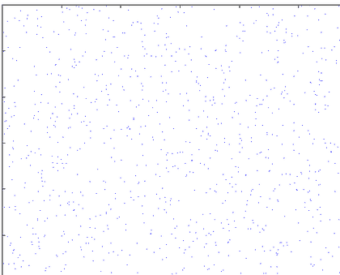
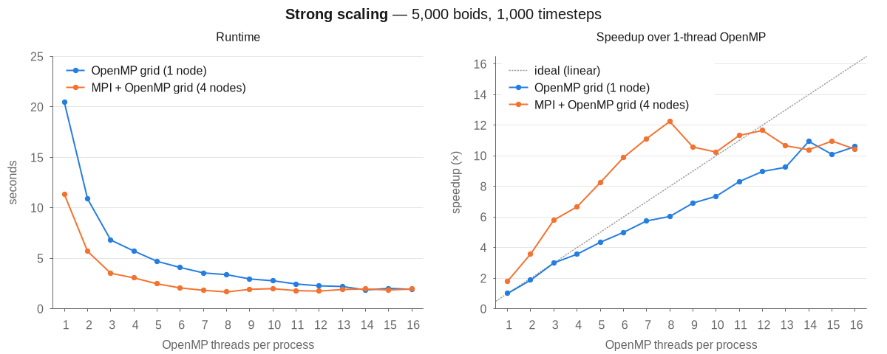
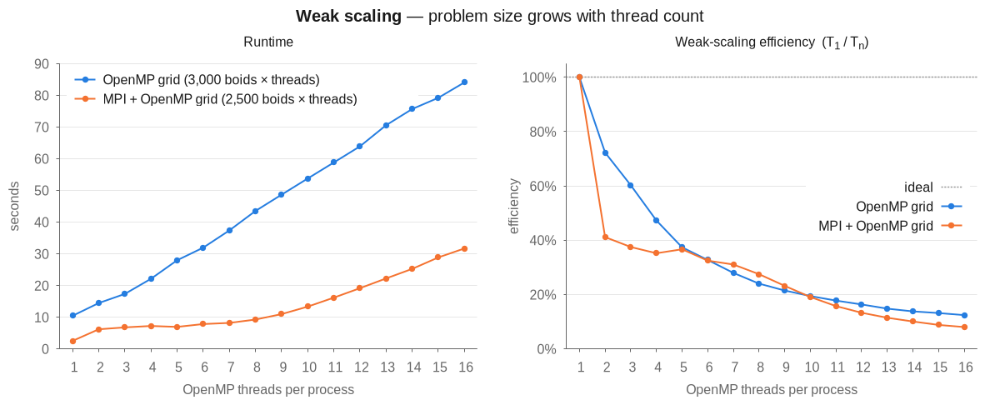
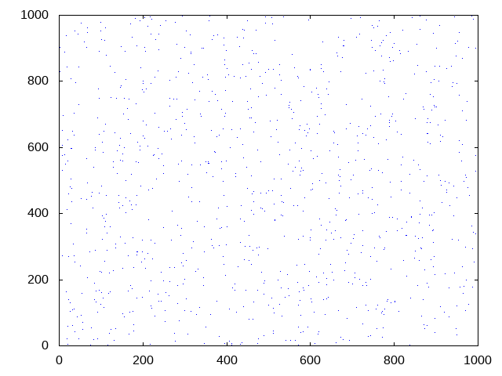
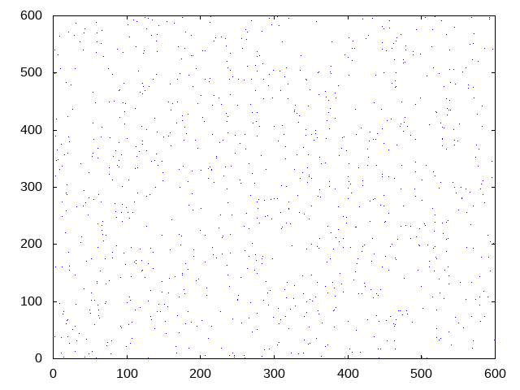

# Boids

<p align="center">
  
</p>

My implementation of Craig Reynolds' boids (flocking) in C++. I started with a basic serial version and
kept adding stuff until it ran on multiple nodes with MPI + OpenMP. This was for my parallel programming
course, so most of the work went into making it fast and measuring how well it scales.

Each boid does the usual three things:

- **separation**: move away from boids that are too close (`PRANGE`)
- **alignment**: match the velocity of the boids it can see (`VRANGE`)
- **cohesion**: move toward the center of the boids it can see

On top of that, boids turn around when they get near a wall, they can only see things inside a 120° field
of view, and their speed is clamped between `MINSPEED` and `MAXSPEED`. All the constants live in `src/config.h`
if you want to mess with them.

## Versions

There are 5 programs, roughly in the order I wrote them:

| program | what it does |
|---|---|
| `main_serial` | brute force, every boid checks every other boid, O(N²) |
| `main_omp` | same thing but with an OpenMP `parallel for` |
| `main_serial_grid` | splits the world into a grid so boids only check nearby cells |
| `main_omp_grid` | grid + OpenMP over the grid cells |
| `main_omp_mpi_grid` | grid + OpenMP, and the world is split into 4 chunks with MPI |

### The grid

The world is 800x800 and the grid cells are 40px (same as the visual range), so anything a boid can see is
either in its own cell or one of the 8 around it. Each cell is a doubly linked list of boid indices
(the `next`/`prev` fields on the boid), which makes moving a boid between cells cheap.

### MPI

The MPI version splits the world into a 2x2 grid with one rank per quadrant, so it only works with
**exactly 4 ranks**. After every step each rank sends the boids in its border cells to its neighbours
(including the diagonal one) using non-blocking sends, and boids that crossed over get handed off to the new rank.
I made a custom MPI datatype for the boid struct so I could send them directly.

When frame output is on, every rank writes its own file and rank 0 stitches them together
(`aggregate_partial` in `src/processing.cpp`).

## Results

All of these are 1000 timesteps, run on the course cluster (16 cores per node). The raw data is in
`results/` and the plots come from `scripts/plot_scaling.gp`.

### Strong scaling (5000 boids)



| threads | OpenMP grid (1 node) | MPI + OpenMP (4 nodes) |
|---:|---:|---:|
| 1  | 20.43s | 11.33s |
| 4  | 5.72s  | 3.06s  |
| 8  | 3.39s  | 1.67s  |
| 16 | 1.93s  | 1.96s  |

OpenMP alone gets about a 10.6x speedup on 16 threads. The MPI version is almost 2x faster at the start,
and its best run was 8 threads per rank (about 12x). After that it stops getting faster. I think it's because
5000 boids split 4 ways isn't much work per rank anymore, so the communication and the `omp critical`
section for updating the grid start to dominate.

### Weak scaling



The weak scaling doesn't look great, but that's mostly because of how I set it up. The world size stays the
same while I add more boids, so the grid cells just get more crowded and each boid has more neighbours to check.
That means the work per thread actually goes up as I add threads instead of staying constant.

## Animations

| serial | OpenMP grid |
|:---:|:---:|
|  |  |

There are also reference animations with [1000 boids](docs/media/reference_1000.gif) and [10000 boids](docs/media/reference_10000.gif).

## Building / running

You need `mpicxx` with OpenMP. For the animations you also need gnuplot, GNU parallel and ImageMagick.

```bash
make    # binaries end up in bin/

./bin/main_serial_grid 2000                 # argument is the number of boids
OMP_NUM_THREADS=8 ./bin/main_omp_grid 5000
mpirun -np 4 -x OMP_NUM_THREADS=4 ./bin/main_omp_mpi_grid 5000
```

Each program just prints how long the simulation took (in seconds).

To make a gif, set `PER` in `src/config.h` to something non-zero (e.g. 1), rebuild, run it, and then:

```bash
scripts/plot.sh 5000 boids_omp_grid_ out.gif   # num boids, prefix of the .bin files, output
```

`scripts/compare.sh a.gif b.gif` puts two gifs side by side, which I used to check my versions against the reference.

For the scaling runs I used the SLURM scripts in `jobs/` (submit them from the repo root). They print
`threads seconds` lines into the job log, which I copied into `results/` and then ran
`gnuplot scripts/plot_scaling.gp` to make the plots. `jobs/modules.sh` has the modules I loaded on the cluster.

## Layout

```
src/        all the C++ code (config.h has the simulation constants)
scripts/    gif rendering + plotting scripts
jobs/       SLURM job scripts
results/    timing data
docs/media/ images and gifs for this readme
```
